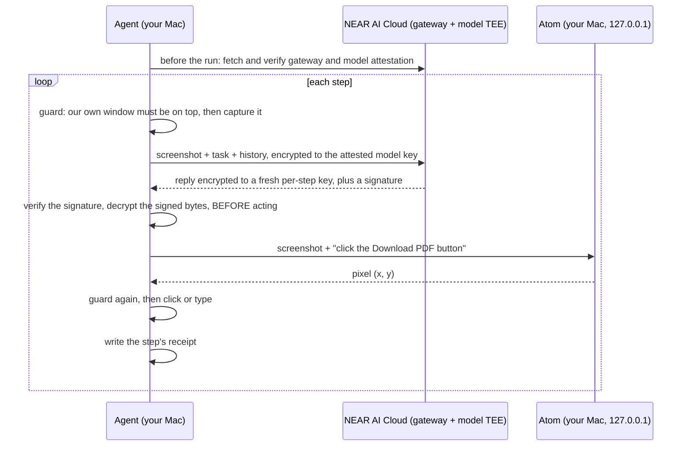
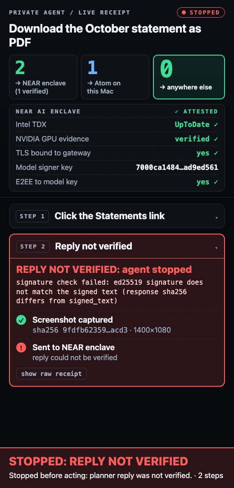

# Private computer-use agent

> Your screen is the most private data you have. Every pixel either stays on your Mac or goes only to an attested enclave.

<!-- DEMO VIDEO -->


An agent that operates your Mac's screen for you. A vision model reads the screenshot and picks the next action. A small local model turns that action into a click position. Each step leaves a receipt that you can check offline.

- **Planner:** `Qwen/Qwen3.8-27B` on [NEAR AI Cloud](https://docs.near.ai/cloud/private-inference.md), in a trusted execution environment (TEE). The screenshot is end-to-end encrypted to the model's attested key.
- **Grounding:** Atom, a 0.27B-parameter model that runs on your Mac and answers on `127.0.0.1`.
- **Receipts:** every planner reply is signed by the model's enclave. `python -m agent verify <run>` checks, offline, that each reply is bound to its run, step and screenshot and that the recorded decision is what the enclave signed.

## How it works



What is checked, and when:

| When | What | Code |
|---|---|---|
| Before the run | Gateway and model attestation (Intel TDX quote, NVIDIA GPU evidence, TLS bound to the attested gateway), done by the NEAR SDK. The agent stops if the model has no enclave report. | `Planner.start` in `agent/planner.py` |
| Before each capture | The agent's own window covers the whole work area and no other app's window is in front of it, except the Dock, which the check ignores (see Limits). | `run_task` in `agent/loop.py`; `check_region` in `agent/screen.py` |
| Before each action | The reply's signature is valid, is from the model enclave (`provider_tee`), covers the exact bytes sent and received, the signer is one attested before the run, and the signed request carries this run, step and screenshot hash. The agent then decrypts the signed response bytes itself and acts on that action. It refuses if the SDK's parsed action differs. Any failure stops the run before anything is executed. | `Planner.plan`, `Planner._check` in `agent/planner.py`; `run_task` in `agent/loop.py` |
| Before a click | The point must belong to the work browser's window, checked again at the instant the mouse goes down. | `Guard.check_point`, `screen.click` |
| Before typing or a key | The full region check and a frontmost-app check (the work browser must have focus), before the first keystroke and again before every key event. | `Guard.check_keys`, `screen.guard_keyboard` |
| Which keys | Only: `enter`, `return`, `tab`, `escape`, `backspace`, `delete`, `up`, `down`, `left`, `right`, `pageup`, `pagedown`, `space`, `cmd+a`. Anything else is refused and nothing is pressed. The planner's JSON schema and prompt carry the same list. | `ALLOWED_KEYS` in `agent/screen_keys.py` |
| Afterwards | `python -m agent verify <run>` re-checks every step from the saved files. | `agent/verify.py` |

The planner returns a target described in words ("the Download PDF button"), never coordinates. Atom finds the position on your Mac. The agent retries Atom once with a rephrased target (`_ground` in `agent/loop.py`). The step budget is 12 by default (`--max-steps`).

## What leaves your Mac

Screenshots go to one place only, NEAR AI Cloud (`https://cloud-api.near.ai/v1`), and only encrypted. Three kinds of traffic leave the Mac.

**1. To NEAR AI Cloud, each step.**

- The screenshot of the work area, the task text and a text history of earlier steps. They are encrypted on your Mac to the model's attested public key (end-to-end encryption, E2EE). In the recorded request `tests/fixtures/run/step-1.request.bin`, `messages` is hex ciphertext, not text.
- In the clear, visible to the gateway: your NEAR API key, and the request fields that are not encrypted: the model name, the output-token limit, temperature, the output format schema, the `chat_template_kwargs` flag, and a `user` field of the form `<run_id>:<step>:<screenshot sha256>`. That field holds the run id, the step number and the SHA-256 of the screenshot. It is a hash, not pixels. It is there so the enclave's signature covers it, which ties each signature to one run, one step and one screenshot. The network also sees the size and timing of each request.

**2. Attestation checks, from inside the NEAR SDK (not from this repo's code).** When `Planner.start` calls `InferenceClient.verify()`, the SDK (`nearai-inference-sdk` 0.3.0) contacts two more services directly. I traced this in the installed SDK; the agent passes no custom verifiers, so the SDK defaults apply.

- **Intel PCCS, `api.trustedservices.intel.com`.** The default quote verifier `verify_dcap_quote` calls `dcap_qvl.get_collateral(pccs_url, quote_bytes)` for the gateway's and the model's TDX quote (`nearai_inference_sdk/utils/intel.py:52`; default chosen at `core/dstack_attestation.py:70-74`; URL in `utils/consts.py:1`). It fetches Intel's certification data for that hardware. The collateral lookup is keyed on identifiers read from the quote (the library's docstring names the FMSPC). The compiled `dcap-qvl` library builds the requests; their exact bytes have not been inspected.
- **NVIDIA attestation service, `nras.attestation.nvidia.com`.** The model's GPU evidence is POSTed there and NVIDIA's signing keys are fetched from `/.well-known/jwks.json` (`core/attestation_model.py:148-166`, `utils/nvidia.py:76` and `:126`; URL in `utils/consts.py:3`). The body is the GPU attestation report the gateway handed the SDK, which includes the nonce for this check.
- **What these two receive:** attestation evidence for NEAR's servers, plus your IP address and the time. They do not receive screenshots, the task, history, your API key or run ids. The NVIDIA request carries only `content-type: application/json`.
- **When:** once per run in `Planner.start` (`InferenceClient.verify`, `core/inference_client.py:265-278`). The SDK caches the result for a limited time, so a long run may repeat it (`_start_verification`, called by `verify` and by every chat request, `core/inference_client.py:277` and `:321`).
- **Not called:** the SDK's GitHub provenance lookups (`core/provenance.py`, `core/compose_manager_provenance.py`) only run when a `deployment_policy` is set (`core/inference_client.py:572, 834`), and the agent sets none.
- `agent/egress.py` guards the paths a screenshot can take. It does not wrap the SDK's own attestation calls, which is why they are listed here.

**3. To Atom, on your own machine.** The screenshot goes to `http://127.0.0.1:8760`. It does not leave the Mac.

How this is enforced:

- **Egress allowlist.** `agent/egress.py` allows one planner URL and one Atom URL. `tests/test_egress.py` fails if any other module in `agent/` imports a network client.
- **Atom is loopback-only.** The Atom URL must be an `http://` loopback IP literal, with no credentials. A name such as `localhost` is refused because names can be re-pointed (`check_atom_url` in `agent/egress.py`). The Atom call bypasses system HTTP proxies (`_call` in `agent/grounder.py`).
- **Atom's server defends itself.** It refuses a foreign `Host` header, any request with an `Origin` header and any POST that is not JSON. `image_path` is off unless the server is started with `--allow-image-path`. Each screenshot is written to its own file in a private 0700 directory and deleted right after grounding (`atom/server/atom_api.py`, [atom/README.md](atom/README.md)).
- **Fail-closed window guard.** The agent captures and acts only while its own browser window covers the work area. A notification, another app's window, or any foreign overlay in front of it stops the run. The one exception is the Dock: `run.sh` refuses to start unless it is set to hide automatically (`check_dock` in `agent/screen.py`) (`agent/screen.py`, `tests/test_guard.py`, `tests/test_keys.py`).
- **The agent only acts in a browser this run launched.** `--work-pid` is accepted only if the process was started with the run's own temporary `--user-data-dir` (the `--work-profile` that `run.sh` creates). The agent cannot be pointed at your own, logged-in browser (`check_work_pid` in `agent/browser.py`).
- **Screenshots are not stored by default.** Capture goes through a temporary file that is deleted on return (`capture` in `agent/screen.py`). `--keep-screenshots` turns saving on, prints a warning, and writes the files with mode 0600. They are plaintext: delete them before sharing a receipt folder.
- **End-to-end encryption is always on.** There is no flag to turn it off, and `verify` fails a run whose request messages are not ciphertext.
- **Only the work area is captured**: the left 1400 points wide, from the bottom of the menu bar to y = 1080, which is 1400 x 1050 with a 30-point menu bar (the code clips by the real menu bar height). The receipt panel sits to its right and is never in a screenshot (`WORK_AREA` in `agent/loop.py`, `clip_below_menubar` in `agent/screen.py`).

## Proof, per step

Each run writes `receipts/<run_id>/`: `events.jsonl`, `attestation.json`, and for every step `step-N.json`, `step-N.request.bin`, `step-N.response.bin` and `step-N.reply_key.hex` (`agent/receipts.py`). A receipt contains:

- the screenshot's SHA-256 and size (not the screenshot, unless you used `--keep-screenshots`),
- the exact bytes sent to and received from the gateway (ciphertext under E2EE),
- the enclave's signature, signer, and signed text,
- the action the agent recorded, and what it did,
- a per-step reply key. It decrypts only that step's reply. It cannot decrypt the request, so the screenshot stays sealed (`tests/test_verify.py`, `test_reply_key_cannot_decrypt_the_request`).

**What `verify` proves, plainly.** The planner's reply, which is the decision, is bound to the bytes the model enclave signed, and to one run, one step and one screenshot hash. It does **not** prove what the agent's clicks and keystrokes did on screen. The `acted` events and the action performed in `step-N.json` are the agent's own record. Nothing signs them.

`python -m agent verify <run>` runs without a network connection and exits 1 on any FAIL. Per step it checks:

1. **hashes**: SHA-256 of the saved request and response bytes equals the two hashes inside the signed text.
2. **signature**: the enclave's signature over the signed text is valid (ed25519 or ecdsa).
3. **signer**: the signer is one of the model signers attested before the run, as recorded in `attestation.json`.
4. **bound**: the request's clear-text `user` field equals `<run_id>:<step>:<screenshot sha256>` from `events.jsonl`, so a signed step cannot be moved into another run or paired with another screenshot.
5. **action**: the step's reply key decrypts the signed response, and the action inside equals the action recorded in the receipt.

Across the run it also fails when: the reply key is missing (unless `--allow-unbound`, which labels the result weaker), steps are not exactly 1..N or disagree with `events.jsonl` and `run_finished.steps`, a step file disagrees with its event, a REFUSED step is not earned (it must be the last step, with a `guard_blocked` or `planner_unverified` event and no `acted` event), the run's ending does not match `run_finished.status` (`done` needs a last signed action `done`, `failed` needs `fail`, `stopped` needs a refused last step or the step budget `run_started.max_steps`), a signed `done` or `fail` is not the last step, a gateway signature appears without `--allow-gateway-signature` in `run_started`, the request messages are not ciphertext, or `e2ee` was off.

Sample output, from the recorded run in `tests/fixtures/run` (`uv run python -m agent verify tests/fixtures/run`):

```
run run  model Qwen/Qwen3.8-27B  attested signer 89154a43a4768474...
step result   kind         hashes  signature signer  bound  action    recorded
1    PASS     provider_tee ok      ok        ok      ok     ok        click the Settings button
2    PASS     provider_tee ok      ok        ok      ok     ok        click the Save changes button
3    PASS     provider_tee ok      ok        ok      ok     ok        done
PASS: 3 of 3 step(s) verified; every step's signed reply is bound to its run, step and screenshot and is consistent with events.jsonl
```

Change one byte of a saved response and the check fails (`tests/test_verify.py`, `test_tampered_response_byte_fails`). If a live reply fails the check, the agent stops before acting and the panel says so (this one is replayed from `panel/sample/unverified-run`, not a live run):



Details and code references: [docs/VERIFICATION.md](docs/VERIFICATION.md).

## NEAR tools used

| Tool | Where it is used |
|---|---|
| [NEAR AI Cloud private inference](https://docs.near.ai/cloud/private-inference.md), through its [OpenAI-compatible API](https://docs.near.ai/cloud/guides/openai-compatibility.md) | The planner call: `Qwen/Qwen3.8-27B`, `chat.completions.create` in `Planner.plan` (`agent/planner.py`). |
| [Gateway attestation](https://docs.near.ai/cloud/verification/cloud-api/gateway-attestation.md) and [TLS connection binding](https://docs.near.ai/cloud/verification/cloud-api/tls.md) | Checked before the run by the SDK; the result is stored in `attestation.json` (`gateway` block). |
| [Model attestation](https://docs.near.ai/cloud/verification/cloud-api/model-attestations.md) | Checked before the run; the agent refuses a model with no enclave report. The attested model signers are recorded and later compared with each reply's signer. |
| [Response signatures](https://docs.near.ai/cloud/verification/cloud-api/response-signatures.md) (`provider_tee`) | Required for every step. A gateway-only signature is refused unless you pass `--allow-gateway-signature` (`Planner._check`), and `verify` then labels the result. |
| [End-to-end encrypted chat completions](https://docs.near.ai/cloud/guides/e2ee-chat-completions.md) | Always on (`Planner.__init__` refuses anything else). |
| [`nearai-inference-sdk`](https://docs.near.ai/cloud/inference-sdk/python.md) (Python), pinned to 0.3.0 | `InferenceClient(e2ee=True)`, `verify`, `verify_response` (`Planner.__aenter__`, `start`, `plan`; `pyproject.toml`). |

## Atom, the local grounding model

- A 4-bit quantized deployment of Samsung TinyClick (Florence-2-base lineage), about 0.27B parameters. The download is about 149 MB compressed and 169 MB installed. It has no additional gradient updates.
- **75.9% on ScreenSpot v2 (966 of 1,272).** This is the author's own evaluation. It is not on a public leaderboard. Evidence: [akshatcoder-hash/atom-screenspot-v2](https://github.com/akshatcoder-hash/atom-screenspot-v2).
- Runs locally with MLX, on Apple silicon only. It returns a click point or abstains.
- Installed from this repo's [`atom-v1` release](https://github.com/akshatcoder-hash/private-computer-use-agent/releases/tag/atom-v1). The archive's SHA-256 and every extracted file's SHA-256 are pinned in `atom/runtime/model-manifest.json` and checked before anything is installed.
- Read [atom/README.md](atom/README.md) for the API and [atom/NOTICE.md](atom/NOTICE.md) for licensing and open points.

## Run it

You need:

- A Mac with Apple silicon, running macOS, and a main display of at least 1920 x 1080 points (the work area is 1400 wide and the receipt panel 520). `run.sh` refuses a smaller one.
- [`uv`](https://docs.astral.sh/uv/).
- A [NEAR AI Cloud](https://cloud.near.ai) API key with credit, as `NEARAI_API_KEY=...` in a `.env` file in this directory (or exported).
- Three macOS permissions for the terminal app you run this from: Screen Recording, Accessibility, and Automation for "System Events" (the agent uses it to bring its own window to the front). `run.sh` checks all three and says which is missing.
- A Chromium-family browser is required: Google Chrome, or Playwright's Chromium (install it with `uv run --with playwright python -m playwright install chromium`). Set `BROWSER` to use another one.
- "Automatically hide and show the Dock" turned on (System Settings > Desktop & Dock). The work window needs the full 1080-point height; `run.sh` refuses to start with a visible Dock.
- On a Retina display the capture is at pixel resolution, so the images are larger and use more tokens.

```bash
./run.sh --demo                                   # the hero task on the bundled mock bank site
./run.sh "<task>" --start-url https://example.com # your own task, in a fresh browser window
```

`--demo` runs "Download the October statement as PDF" on a mock bank site (`demo/`). It then checks that the site logged the download.

The first run downloads Atom's runtime and model (sizes above). That is a one-time step and can take several minutes. Atom's log is `~/Library/Logs/private-agent/atom.log`; it is kept after the run so a failed start can be diagnosed. `run.sh` opens two windows: the work area (a 1400 x 1080 window at the left, of which the part below the menu bar is captured) and the live receipt panel (520 x 1080, right). When the run ends it runs `verify` on the new receipt and prints the result. `run.sh` and the agent use `uv run python`.

Some apps keep an invisible overlay window on screen, for example a dictation widget. The guard treats it as covering the work area and blocks the run. To allow a specific app's overlay, opt in by name: `AGENT_ALLOW_OVERLAYS="Wispr Flow" ./run.sh ...` (or `--allow-overlay`). The name must match the window's owner name.

Useful flags: `--max-steps`, `--keep-screenshots`, `--allow-gateway-signature`, `--allow-overlay` (`python -m agent run --help`). `verify` takes `--allow-unbound` for old receipts.

## Results

Three tasks, five consecutive passing runs each, on one Apple M4 Mac: the hero task (download the October statement as PDF from the mock bank), a $250 transfer on the same bank, and a Wikipedia search that opens the article. Success was judged outside the agent (the bank's event log, the browser's final URL), and every run also passed `verify` with the default (strict) verifier.

- Median planner latency per step: 8.19 s (hero), 7.33 s (transfer), 6.52 s (Wikipedia). Steps are 4, 8 and 3; median wall time per run is 75 s, 113 s and 43 s.
- Median Atom latency per click: 0.43 s, 0.43 s, 0.51 s.

This is 5 consecutive runs per task on one machine, not a pass rate. In these runs one transfer run crashed on a timed-out `osascript` call (fixed since), and three hero runs were stopped by the window guard when a notification banner came forward (those did not count toward the streaks). Planner latency was 4 to 5 times higher than in an earlier measurement, for a reason that was not investigated. The full list of runs, failures and what is not verified is in [docs/RUNS.md](docs/RUNS.md).

## Limits

- **A receipt does not prove which serving instance answered.** NEAR documents that instances of one model share a signing key ([model attestations](https://docs.near.ai/cloud/verification/cloud-api/model-attestations.md), [response signatures](https://docs.near.ai/cloud/verification/cloud-api/response-signatures.md)).
- **`verify` covers the decision, not the effect.** It shows what the enclave said for this run, step and screenshot hash. What the clicks and keys then did on screen is the agent's own, unsigned record.
- **Attestation shows what code runs, not that the answer is good.** The planner can pick a wrong step. The agent can make mistakes on real sites.
- **The agent drives a real browser with no navigation allowlist.** Page text is untrusted input to the planner (prompt injection). A page can try to talk the model into a harmful step. That is why the agent acts only in its own window, has a step budget (12 by default), and may press only a short list of keys. These limit the damage. They do not make a hostile page safe, and what you can do in that browser, the planner can attempt. Do not point it at sessions or data you would not trust it with.
- **Downloads are automatic in the work browser.** `run.sh` sets automatic downloads in the work browser's temporary profile, so a page can save files without a prompt. They land in a temporary folder that is removed when the run ends.
- **The gateway sees your API key and the unencrypted request fields** listed above, including the run id, step and screenshot hash. Intel and NVIDIA see attestation evidence during the check (see "What leaves your Mac").
- **The agent trusts your Mac.** Malware or a compromised OS on the Mac can read the screen, the `.env` key, and the saved reply keys.
- **The Dock can slide over the bottom of the work area.** The window guard ignores the Dock. `run.sh` requires auto-hide, but the Dock appears when the pointer reaches the screen edge. It shows app icons only.
- **Services already on the loopback ports are reused.** `run.sh` reuses anything already answering on `127.0.0.1:8760` (Atom) or `127.0.0.1:8765` (panel). A hostile local process there would receive screenshots. This falls under "the agent trusts your Mac", stated explicitly.
- **A page can trigger external URL handlers** (`mailto:`, `facetime:` and similar). These may open another app after a confirmation dialog; the window guard then stops further steps.
- **`verify` cannot prove a run was not deleted or cut short in a way that looks like a stop.** It requires the ending to match the last signed action: a `done` or `fail` that the enclave signed for that position. Someone who can edit the folder can drop trailing steps only by relabelling the run `stopped` (the guard and budget events are unsigned) or by deleting the run. They cannot forge a `done` or `fail`.
- **Offline `verify` checks the receipt against `attestation.json` in the same folder.** It does not re-check the Intel TDX quote or the GPU evidence. Those are checked by the SDK at run time, and `attestation.json` holds only a summary of the result. Someone who can edit the whole folder can write a consistent fake, including a matching `events.jsonl`. Verification is meaningful when the receipt reaches you from a run you trust, or when you compare the signer with a fresh attestation yourself. The screenshot hash can be checked against a screenshot only if the run kept one (`--keep-screenshots`).
- **Under E2EE the saved bytes are ciphertext.** The action in a receipt is tied to the signed reply only through the saved reply key. A receipt without `reply_key.hex` fails, unless you pass `--allow-unbound`, which prints `not bound` and a weaker summary.
- **Receipts are not secret.** `step-N.json` holds the task, the planner's one-sentence thought, its summary, and any text it asked to type. These can describe what was on screen. Do not publish a receipt folder from a sensitive run without reading it.
- **The panel serves receipts over loopback.** It listens on `127.0.0.1:8765` (`panel/server.py:167`), so any process on your Mac can read them there while it runs.
- **Atom is small.** It can miss on busy pages, or click the wrong thing. If Atom cannot place a target after one retry, nothing is clicked. The failure goes into the planner's history and the run continues until the step budget (`_act` and `run_task` in `agent/loop.py`).
- **macOS and Apple silicon only.** The agent uses Quartz and `screencapture`; Atom uses MLX (`agent/screen.py`, `atom/README.md`).

## Repo layout

| Path | What |
|---|---|
| `run.sh` | One command: checks, starts Atom, panel and demo site, opens the windows, runs, verifies. |
| `agent/` | The agent: `planner.py` (NEAR call and checks), `loop.py` (capture, plan, ground, act), `screen.py` (capture, input, window guard), `screen_keys.py` (key allowlist), `egress.py`, `grounder.py` (Atom client), `receipts.py`, `verify.py` (offline check), `browser.py` (work browser, `--work-pid` check). |
| `atom/` | Atom's local runtime, installer and manifest, with upstream licence notices. |
| `panel/` | The live receipt panel (standard-library server, one HTML page). |
| `demo/` | Mock bank site used by `--demo`. |
| `m1/` | The two checks that came first: one planner call, one grounded click. |
| `tests/` | Unit tests, and a recorded run in `tests/fixtures/run`. |
| `docs/` | [VERIFICATION.md](docs/VERIFICATION.md), `RUNS.md`. |

Tests (no screen, key or network needed):

```bash
uv run python -m unittest discover -s tests -v
python3 -m unittest discover -s atom/tests -v
```

## License

MIT for this project's code ([LICENSE](LICENSE)). Atom's runtime code is MIT. Atom's weights derive from Microsoft Florence-2 and Samsung TinyClick under MIT; their notices travel with the model. See [atom/NOTICE.md](atom/NOTICE.md) and [atom/LICENSE](atom/LICENSE).
