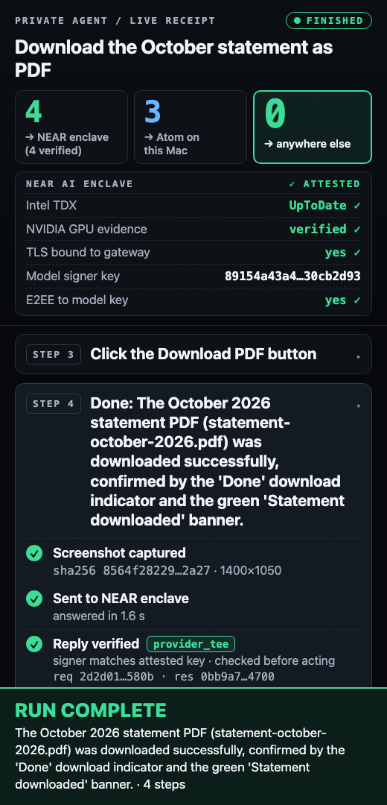
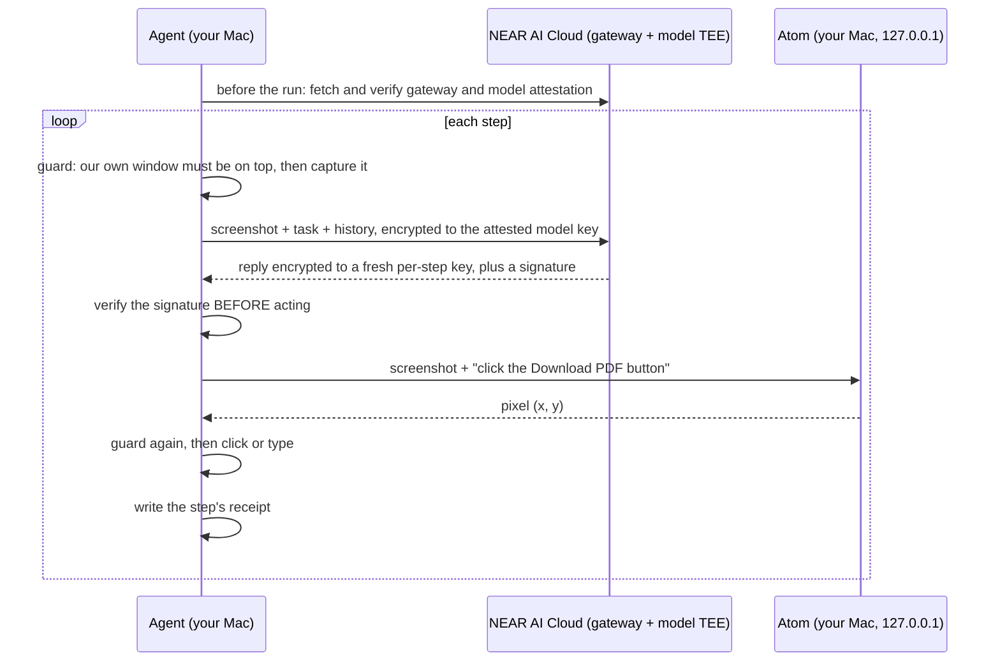

# Private computer-use agent

> Your screen is the most private data you have. Every pixel either stays on your Mac or goes only to an attested enclave.

<!-- DEMO VIDEO -->
<!-- TODO(WP7): replace this line with the demo video link, and add the screenshot at docs/media/panel.png (the receipt panel mid-run). The image does not exist yet. -->


An agent that operates your Mac's screen for you. A vision model reads the screenshot and picks the next action. A small local model turns that action into a click position. Each step leaves a receipt that you can check offline.

- **Planner:** `Qwen/Qwen3.8-27B` on [NEAR AI Cloud](https://docs.near.ai/cloud/private-inference.md), in a trusted execution environment (TEE). The screenshot is end-to-end encrypted to the model's attested key.
- **Grounding:** Atom, a 0.27B-parameter model that runs on your Mac and answers on `127.0.0.1`.
- **Receipts:** every planner reply is signed by the model's enclave. `python -m agent verify <run>` checks that signature, and the action the agent took, offline.

## How it works



What is checked, and when:

| When | What | Code |
|---|---|---|
| Before the run | Gateway and model attestation (Intel TDX quote, NVIDIA GPU evidence, TLS bound to the attested gateway), done by the NEAR SDK. The agent stops if the model has no enclave report. | `agent/planner.py:234-242` |
| Before each capture | The agent's own window covers the work area and nothing from another app is in front of it. | `agent/loop.py:167-169`, `agent/screen.py:127-148` |
| Before each action | The reply's signature is valid, is from the model enclave (`provider_tee`), covers the exact bytes sent and received, and the signer is the one attested before the run. If any of this fails, nothing is executed and the run stops. | `agent/planner.py:320-346`, `agent/loop.py:184-187` |
| Right before a click or keystroke | The window guard runs again, at the instant the event is posted. | `agent/loop.py:103-110`, `agent/screen.py:151-174` |
| Afterwards | `python -m agent verify <run>` re-checks every step from the saved files. | `agent/verify.py` |

The planner returns a target described in words ("the Download PDF button"), never coordinates. Atom finds the position on your Mac. The agent retries Atom once with a rephrased target (`agent/loop.py:76-91`). The step budget is 12 (`agent/__main__.py:88`).

## What leaves your Mac

Exactly these, and only to NEAR AI Cloud (`https://cloud-api.near.ai/v1`):

1. **The screenshot of the work area, the task text, and a text history of earlier steps.** They are encrypted on your Mac to the model's attested public key (end-to-end encryption, E2EE). In the recorded request in `tests/fixtures/run/step-1.request.bin`, the `messages` field is hex ciphertext, not text.
2. **In the clear to the gateway:** your NEAR API key and the request fields that are not encrypted: the model name, the output-token limit, temperature, the output format schema, and the `chat_template_kwargs` flag (same file). The network also sees the size and timing of each request.

Nothing else is sent anywhere. Atom is reached only on your own machine.

How this is enforced:

- **Egress allowlist.** `agent/egress.py` allows one planner URL and one Atom URL. `tests/test_egress.py` fails if any other module in `agent/` imports a network client.
- **Atom is loopback-only.** The Atom URL must be an `http://` loopback IP literal, with no credentials. A name such as `localhost` is refused because names can be re-pointed (`agent/egress.py:23-32`). The Atom call bypasses system HTTP proxies (`agent/grounder.py:22`).
- **Fail-closed window guard.** The agent captures and acts only while its own browser window covers the work area. A notification, another app's window, or any foreign overlay in front of it stops the run (`agent/screen.py:40-160`, `tests/test_guard.py`).
- **Screenshots are not stored by default.** Capture goes through a temporary file that is deleted on return (`agent/screen.py:196-205`). `--keep-screenshots` turns saving on (`agent/__main__.py:90`).
- **Only the work area is captured**, the left 1400 x 1080 region below the menu bar. The receipt panel sits to its right and is never in a screenshot (`agent/loop.py:14,140`).

## Proof, per step

Each run writes `receipts/<run_id>/`: `events.jsonl`, `attestation.json`, and for every step `step-N.json`, `step-N.request.bin`, `step-N.response.bin` and `step-N.reply_key.hex` (`agent/receipts.py`). A receipt contains:

- the screenshot's SHA-256 and size (not the screenshot),
- the exact bytes sent to and received from the gateway (ciphertext under E2EE),
- the enclave's signature, signer, and signed text,
- the action the agent recorded, and what it did,
- a per-step reply key. It decrypts only that step's reply. It cannot decrypt the request, so the screenshot stays sealed (`tests/test_verify.py`, `test_reply_key_cannot_decrypt_the_request`).

`python -m agent verify <run>` runs without a network connection and checks, per step:

1. **hashes**: SHA-256 of the saved request and response bytes equals the two hashes inside the signed text.
2. **signature**: the enclave's signature over the signed text is valid (ed25519 or ecdsa).
3. **signer**: the signer equals the model signer attested before the run, as recorded in `attestation.json`.
4. **action**: the step's reply key decrypts the signed response, and the action inside equals the action recorded in the receipt.

Sample output, from the recorded run in `tests/fixtures/run` (`uv run python -m agent verify tests/fixtures/run`):

```
run run  model Qwen/Qwen3.8-27B  attested signer 89154a43a4768474...
step result   kind         hashes  signature signer  action     recorded
1    PASS     provider_tee ok      ok        ok      ok         click the Settings button
2    PASS     provider_tee ok      ok        ok      ok         click the Save changes button
3    PASS     provider_tee ok      ok        ok      ok         done
PASS: 3 of 3 step(s) verified
```

Change one byte of a saved response and the check fails (`tests/test_verify.py`, `test_tampered_response_byte_fails`). Details and code references: [docs/VERIFICATION.md](docs/VERIFICATION.md).

## NEAR tools used

| Tool | Where it is used |
|---|---|
| [NEAR AI Cloud private inference](https://docs.near.ai/cloud/private-inference.md), through its [OpenAI-compatible API](https://docs.near.ai/cloud/guides/openai-compatibility.md) | The planner call: `Qwen/Qwen3.8-27B`, `chat.completions.create` (`agent/planner.py:268`). |
| [Gateway attestation](https://docs.near.ai/cloud/verification/cloud-api/gateway-attestation.md) and [TLS connection binding](https://docs.near.ai/cloud/verification/cloud-api/tls.md) | Checked before the run by the SDK; the result is stored in `attestation.json` (`gateway` block). |
| [Model attestation](https://docs.near.ai/cloud/verification/cloud-api/model-attestations.md) | Checked before the run; the agent refuses a model with no enclave report. The attested model signer is recorded and later compared with each reply's signer. |
| [Response signatures](https://docs.near.ai/cloud/verification/cloud-api/response-signatures.md) (`provider_tee`) | Required for every step. A gateway-only signature is refused unless you pass `--allow-gateway-signature` (`agent/planner.py:322-324`). |
| [End-to-end encrypted chat completions](https://docs.near.ai/cloud/guides/e2ee-chat-completions.md) | On by default (`--no-e2ee` turns it off). |
| [`nearai-inference-sdk`](https://docs.near.ai/cloud/inference-sdk/python.md) (Python), pinned to 0.3.0 | `InferenceClient(e2ee=True)`, `verify`, `verify_response` (`agent/planner.py:227-236,290`, `pyproject.toml`). |

## Atom, the local grounding model

- A 4-bit quantized deployment of Samsung TinyClick (Florence-2-base lineage), about 0.27B parameters, a 169 MB package. It has no additional gradient updates.
- **75.9% on ScreenSpot v2 (966 of 1,272).** This is the author's own evaluation. It is not on a public leaderboard. Evidence: [akshatcoder-hash/atom-screenspot-v2](https://github.com/akshatcoder-hash/atom-screenspot-v2).
- Runs locally with MLX, on Apple silicon only. It returns a click point or abstains.
- Installed from this repo's [`atom-v1` release](https://github.com/akshatcoder-hash/private-computer-use-agent/releases/tag/atom-v1). The archive's SHA-256 and every extracted file's SHA-256 are pinned in `atom/runtime/model-manifest.json` and checked before anything is installed.
- Read [atom/README.md](atom/README.md) for the API and [atom/NOTICE.md](atom/NOTICE.md) for licensing and open points.

## Run it

You need:

- A Mac with Apple silicon, running macOS.
- [`uv`](https://docs.astral.sh/uv/).
- A [NEAR AI Cloud](https://cloud.near.ai) API key with credit, as `NEARAI_API_KEY=...` in a `.env` file in this directory (or exported).
- Screen Recording and Accessibility permission for the terminal app you run this from. `run.sh` checks both and says which is missing.
- A Chromium-family browser: Google Chrome, or Playwright's Chromium. Set `BROWSER` to use another one.

```bash
./run.sh --demo                                   # the hero task on the bundled mock bank site
./run.sh "<task>" --start-url https://example.com # your own task, in a fresh browser window
```

`--demo` runs "Download the October statement as PDF" on a mock bank site (`demo/`). It then checks that the site logged the download.

The first run downloads Atom's runtime and about 150 MB of weights. That is a one-time step and can take several minutes. `run.sh` opens two windows: the work area (1400 x 1080, left) and the live receipt panel (520 x 1080, right). When the run ends it runs `verify` on the new receipt and prints the result.

Some apps keep an invisible overlay window on screen, for example a dictation widget. The guard treats it as covering the work area and blocks the run. To allow a specific app's overlay, opt in by name: `AGENT_ALLOW_OVERLAYS="Wispr Flow" ./run.sh ...` (or `--allow-overlay`). The name must match the window's owner name (`agent/screen.py:90`).

Useful flags: `--max-steps`, `--keep-screenshots`, `--no-e2ee`, `--allow-gateway-signature` (`python -m agent run --help`).

## Results

<!-- RESULTS: filled from docs/RUNS.md -->

Measured pass rates and latencies are in [docs/RUNS.md](docs/RUNS.md).

## Limits

- **A receipt does not prove which serving instance answered.** NEAR documents that instances of one model share a signing key ([model attestations](https://docs.near.ai/cloud/verification/cloud-api/model-attestations.md), [response signatures](https://docs.near.ai/cloud/verification/cloud-api/response-signatures.md)).
- **Attestation shows what code runs, not that the answer is good.** The planner can pick a wrong step. The agent can make mistakes on real sites. That is why it acts only in its own window, and stops after 12 steps by default.
- **The gateway sees your API key and the unencrypted request fields** listed above, plus the size and timing of requests.
- **The agent trusts your Mac.** Malware or a compromised OS on the Mac can read the screen, the `.env` key, and the saved reply keys.
- **Offline `verify` checks the receipt against `attestation.json` in the same folder.** It does not re-check the Intel TDX quote or the GPU evidence. Those are checked by the SDK at run time, and `attestation.json` holds only a summary of the result. Someone who can edit the whole folder can write a consistent fake. Verification is meaningful when the receipt reaches you from a run you trust, or when you compare the signer with a fresh attestation yourself.
- **Under E2EE the saved bytes are ciphertext.** The action in a receipt is tied to the signed reply only through the saved reply key. A receipt without `reply_key.hex` shows `action: not bound` (`agent/verify.py:103-105`).
- **Receipts are not secret.** `step-N.json` holds the task, the planner's one-sentence thought, its summary, and any text it asked to type. These can describe what was on screen. Do not publish a receipt folder from a sensitive run without reading it.
- **The panel serves receipts over loopback.** It listens on `127.0.0.1:8765` (`panel/server.py:167`), so any process on your Mac can read them there while it runs.
- **Atom is small.** It can miss on busy pages, or click the wrong thing. If Atom cannot place a target after one retry, nothing is clicked. The failure goes into the planner's history and the run continues until the step budget (`agent/loop.py:98-99,214`).
- **macOS and Apple silicon only.** The agent uses Quartz and `screencapture`; Atom uses MLX (`agent/screen.py`, `atom/README.md`).

## Repo layout

| Path | What |
|---|---|
| `run.sh` | One command: checks, starts Atom, panel and demo site, opens the windows, runs, verifies. |
| `agent/` | The agent: `planner.py` (NEAR call and checks), `loop.py` (capture, plan, ground, act), `screen.py` (capture, input, window guard), `egress.py`, `grounder.py` (Atom client), `receipts.py`, `verify.py` (offline check), `browser.py`. |
| `atom/` | Atom's local runtime, installer and manifest, with upstream licence notices. |
| `panel/` | The live receipt panel (standard-library server, one HTML page). |
| `demo/` | Mock bank site used by `--demo`. |
| `m1/` | The two checks that came first: one planner call, one grounded click. |
| `tests/` | Unit tests, and a recorded run in `tests/fixtures/run`. |
| `docs/` | [VERIFICATION.md](docs/VERIFICATION.md), `RUNS.md`. |

Tests (no screen, key or network needed):

```bash
uv run python -m unittest discover -s tests -v
python3 -m unittest discover -s atom/tests -v
```

## License

MIT for this project's code ([LICENSE](LICENSE)). Atom's runtime code is MIT. Atom's weights derive from Microsoft Florence-2 and Samsung TinyClick under MIT; their notices travel with the model. See [atom/NOTICE.md](atom/NOTICE.md) and [atom/LICENSE](atom/LICENSE).
